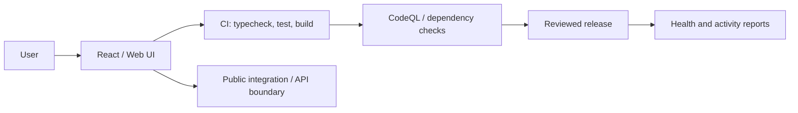

# Architecture Showcase

> Quyidagi oqim public loyihalar uchun reference architecture sifatida berilgan. U private tizimlarning ichki tafsilotlarini ochmaydi.

## Engineering boundaries

- **Delivery:** CI va release workflowlari public repository holatini ko‘rsatadi.
- **Security:** CodeQL, Dependabot va audit workflowlari kuzatiladi.
- **Observability:** Live Pulse, Weekly Highlight va health reportlar faqat real GitHub signallaridan foydalanadi.
- **Privacy:** private repository nomlari, ichki branchlar, tokenlar va secretlar public reportlarga chiqarilmaydi.
